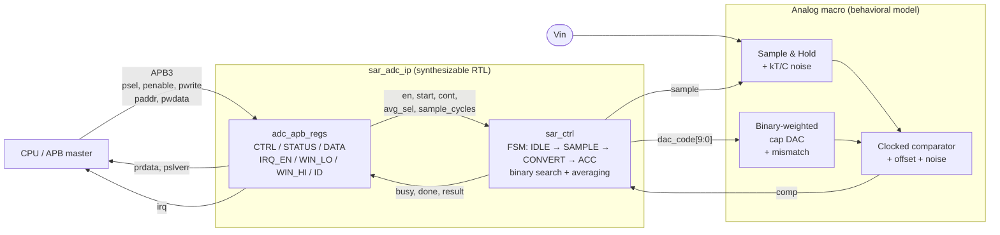
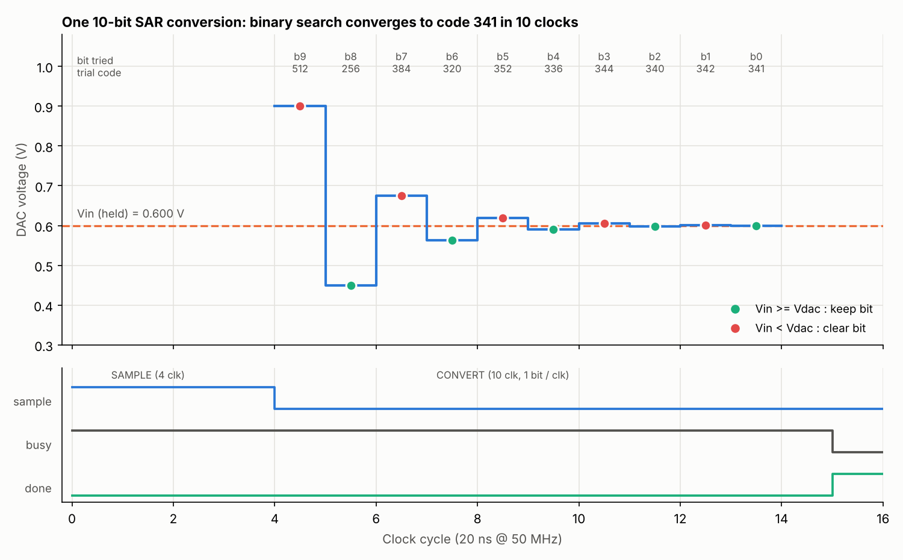
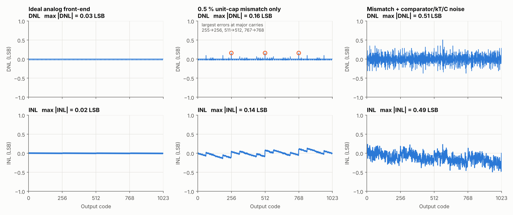
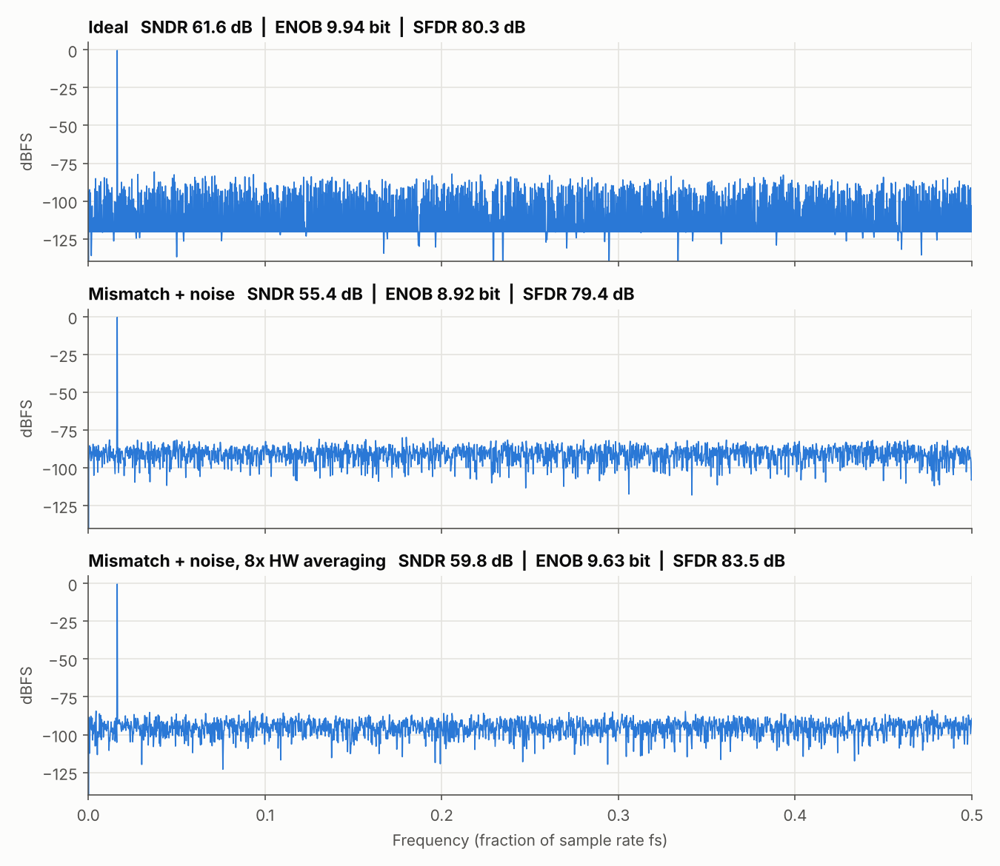

# 10-bit SAR ADC IP with AMBA APB Interface

[](https://github.com/Anish007TML/sar-adc-apb-ip/actions/workflows/ci.yml)

A **mixed-signal IP block** of the kind found in every microcontroller and automotive SoC:
a 10-bit successive-approximation (SAR) analog-to-digital converter with an
**AMBA APB3** register interface, interrupts, hardware averaging and a window
comparator.

The digital part is **synthesizable Verilog**. The analog part (capacitor DAC + comparator)
is a **behavioral model with real non-idealities** (capacitor mismatch, comparator
offset/noise, kT/C noise), so the whole IP can be verified and characterised
(INL / DNL / SNDR / ENOB) in an open-source flow.

| | |
|---|---|
| **Resolution** | 10 bit, VREF = 1.8 V (LSB = 1.758 mV) |
| **Speed** | 15 clocks / conversion → **3.33 MS/s @ 50 MHz** (4-clock sample time) |
| **Bus** | AMBA APB3 slave, zero wait-state, PSLVERR on bad address |
| **Features** | single / continuous mode, programmable sample time, 1/2/4/8× HW averaging, window comparator, EOC / WIN / overrun interrupts |
| **Verification** | 431 self-checking assertions, RTL **and** gate-level, mutation-tested |
| **Measured (sim)** | ideal: **ENOB 9.94 bit**, SNDR 61.6 dB · with 0.5 % cap mismatch + noise: ENOB 8.92 → **9.63 bit with 8× averaging** |
| **Area** | 108 flip-flops + ~600 2-input gates (Yosys, generic library) |

---

## Architecture



### How one conversion works

The SAR logic performs a **binary search**: it tries the MSB first (Vdac = VREF/2), asks
the comparator *“is Vin ≥ Vdac?”*, keeps or clears the bit, and moves to the next bit.
After 10 clocks the DAC code equals the digital output.



---

## Register map (APB, base + offset)

| Offset | Name | Access | Fields |
|---|---|---|---|
| `0x00` | **CTRL** | RW | `[0]` EN · `[1]` START (self-clearing) · `[2]` CONT · `[3]` WIN_EN · `[5:4]` AVG (1/2/4/8×) · `[15:8]` SMP (sample clocks) |
| `0x04` | **STATUS** | R / W1C | `[0]` BUSY (RO) · `[1]` EOC · `[2]` WIN · `[3]` OVR |
| `0x08` | **DATA** | RO | `[9:0]` result (reading clears EOC) |
| `0x0C` | **IRQ_EN** | RW | `[0]` EOC_IE · `[1]` WIN_IE · `[2]` OVR_IE |
| `0x10` | **WIN_LO** | RW | `[9:0]` low threshold |
| `0x14` | **WIN_HI** | RW | `[9:0]` high threshold |
| `0x18` | **ID** | RO | `0x0ADC_0100` (IP id, v1.00) |

`irq = |(STATUS[3:1] & IRQ_EN[2:0])` · unmapped / unaligned address → `PSLVERR = 1`

**Typical driver sequence**
```c
ADC->CTRL = EN | START | (4 << 8);      // enable, 4-clock sample time, go
while (!(ADC->STATUS & EOC)) ;          // or wait for the EOC interrupt
uint16_t code = ADC->DATA;              // read result (clears EOC)
float vin = code * 1.8f / 1024;
```

---

## Results

### Static linearity: INL / DNL (histogram method, 32 hits per code)



* **Ideal**: |DNL|, |INL| < 0.03 LSB (test resolution).
* **0.5 % unit-capacitor mismatch**: the largest DNL errors appear exactly at the
  **major-carry codes 255→256, 511→512, 767→768**, where the most capacitors switch
  at once. The INL becomes a sawtooth: a fingerprint of a binary-weighted DAC.
* **Mismatch + noise**: comparator noise (0.5 LSB rms) spreads the histogram; still
  **no missing codes**, |DNL| ≤ 0.51 LSB.

### Dynamic performance: FFT (coherent sampling, 4096 points, 67 cycles)



| Case | SNDR | ENOB | SFDR | THD |
|---|---|---|---|---|
| Ideal quantizer | 61.6 dB | **9.94 bit** | 80.3 dB | −86.3 dB |
| 0.5 % mismatch + 0.5 LSB noise + 2 mV offset | 55.4 dB | 8.92 bit | 79.4 dB | −79.9 dB |
| same, **8× hardware averaging** | 59.8 dB | **9.63 bit** | 83.5 dB | −86.5 dB |

Sanity check: an ideal 10-bit ADC gives SNDR = 6.02·10 + 1.76 = 61.96 dB at full scale;
the test tone is −0.41 dBFS, so **61.55 dB is expected; the simulation gives 61.6 dB**.

Averaging N samples reduces *random* noise by √N, but **not** the quantization error or
capacitor mismatch (they are deterministic). That's why 8× averaging recovers 0.7 bit
and not the full 1.5 bit.

---

## Verification

```
tb_sar_adc  ──  APB master BFM (apb_write / apb_read tasks)
            ──  DUT: sar_adc_ip         (RTL, or synthesized netlist with -DGLS)
            ──  analog_frontend_model   (real-number model, non-idealities via plusargs)
            ──  protocol checker        (S/H only while busy, PREADY always high)
```

| Test | What is checked |
|---|---|
| `test_regs` | reset values, read/write, read-only ID, PSLVERR on unmapped & unaligned access |
| `test_transfer` | corner codes (0, ½ LSB, mid-scale carry, full scale, over/under-range) + 300 random inputs vs. ideal `floor(Vin/LSB)` |
| `test_timing_avg` | conversion time = AVG × (SMP + 10 + 1) clocks for all 16 settings, averaging and **rounding** |
| `test_window_irq` | window inside/below/above, W1C clearing, EOC IRQ cleared by DATA read |
| `test_continuous` | back-to-back conversions, **overrun** detection, clean stop |
| `test_abort` | disabling mid-conversion leaves no EOC, S/H open, next conversion correct |

**Is the testbench any good?** It was checked with **mutation testing**: 6 deliberate bugs
were injected into the RTL (ignore comparator, broken W1C, no PSLVERR, truncating instead of
rounding, sample-time off-by-one, overrun never set). **All 6 are caught.**

**Gate-level simulation:** the same 431 checks pass on the **Yosys-synthesized netlist**,
proving synthesis did not change behaviour.

---

## Run it yourself

Requirements: `iverilog`, `yosys`, `verilator`, `python3` with `numpy` + `matplotlib`
```bash
sudo apt install iverilog yosys verilator python3-numpy python3-matplotlib
```

```bash
make test      # functional regression  -> "RESULT: PASS (431 checks, 0 errors)"
make lint      # Verilator -Wall lint
make synth     # Yosys synthesis + cell statistics
make gls       # gate-level simulation of the synthesized netlist
make analyze   # ramp + sine sweeps -> INL/DNL/SNDR/ENOB + plots in docs/images/
make wave      # VCD waveform -> open build/tb_sar_adc.vcd in GTKWave
make all       # everything
```

Try your own analog non-idealities:
```bash
vvp -n build/sim.vvp +TEST=sine +TAG=mytest +MISMATCH_PPM=10000 +NOISE_UV=500 +SEED=3
```

---

## Repository layout

```
rtl/
  sar_ctrl.v             SAR FSM: sample, binary search, averaging, continuous mode
  adc_apb_regs.v         APB3 slave registers, W1C flags, window compare, IRQ
  sar_adc_ip.v           top level (synthesizable)
tb/
  analog_frontend_model.v  behavioral cap-DAC + S/H + comparator (real numbers)
  tb_sar_adc.v             self-checking testbench, APB BFM, sweep / trace modes
scripts/
  analyze_adc.py         INL/DNL (histogram) and SNDR/ENOB/SFDR/THD (FFT)
  plot_conversion.py     binary-search visualisation
syn/synth.ys             Yosys synthesis script
docs/
  INTERVIEW_GUIDE.md     how to explain this project + likely questions
  images/                generated plots
.github/workflows/ci.yml lint + test + synth + GLS + analysis on every push
```

---

## Design decisions (and why)

* **SAR architecture.** Best energy per conversion at 8–12 bit / 1–10 MS/s, mostly digital,
  so it scales well with CMOS. That's why it is the standard MCU/automotive ADC.
* **Clocked comparator, decision on the falling edge.** The result is ready before the next
  rising edge, so the comparator output is synchronous: no metastability synchronizer is
  needed and no latency is added.
* **APB, not AHB/AXI.** Low-bandwidth control/status peripheral: APB is the simplest,
  lowest-gate-count AMBA bus and is what MCU peripherals sit on.
* **W1C status flags + read-to-clear EOC.** Avoids read-modify-write races between ISR and
  hardware; a hardware *set* wins over a simultaneous software *clear* so no event is lost.
* **Overrun flag.** In continuous mode software must know when it missed a sample.
* **Window comparator in hardware.** Lets the CPU sleep and wake only when a monitored
  voltage (e.g. battery, sensor) leaves a safe range, a common automotive/IoT need.
* **Hardware averaging with rounding.** Truncation would add a −0.5 LSB bias.

## Future work

* Physical design: OpenLane / OpenROAD place-and-route on SkyWater 130 nm (floorplan, CTS, STA).
* Transistor-level analog macro (StrongARM comparator, split-capacitor DAC) in Cadence Virtuoso
  and co-simulation with this RTL.
* Foreground digital calibration of capacitor mismatch.
* UVM testbench with functional coverage; asynchronous SAR variant (comparator-self-timed).
* DMA request output and multi-channel input mux.
